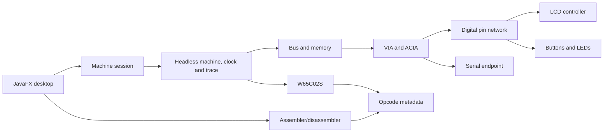

# Architecture

Arrows show use or runtime wiring. Implement machine and device contracts in plain Java. Use Gradle projects for headless hardware, assembly tools and desktop, with shared opcode metadata in a Java-only dependency. Keep fixture runners headless. The CPU publishes a bus operation via a contract and never calls an I/O implementation. ROM images pass from the assembler through a validated machine command. The terminal adapter attaches to the ACIA serial endpoint. An immutable snapshot carries CPU, memory and peripheral state back to the desktop.

## Cycle contract

The session owns mutable state on one execution thread. Timestamp queued user inputs at the next eligible simulation boundary and preserve FIFO order for inputs at the same boundary. Process device deadlines earlier than the CPU edge first. At a coincident timestamp use the profile's documented hardware ordering. The proposed baseline is external inputs and pending device edges, CPU bus phase, then pin/device settling and IRQ publication. The CPU samples interrupt lines at its documented microcycle. Refine edge ordering against the selected chip data and validate it with traces before freezing the contract.

Each emitted bus cycle records cycle, simulated timestamp, address, direction, data and access kind where applicable. Observers cannot add CPU-visible bus accesses. A distinct inspection API exposes read-only bytes and snapshots. Unknown or unmapped inspection addresses are shown as such. Define reset and power-on initialization separately. Cycle step advances one clock; instruction step runs through one retirement or returns a waiting/stopped state when it cannot progress. Continuous operation advances peripherals during WAI and models STP clock behavior explicitly. Counters distinguish CPU cycles, retired instructions and simulated time.

Batch host pacing and snapshots. Preserve in-flight LCD and UART deadlines in simulated time across CPU rate changes. When slower than requested, publish the achieved rate. Burn validates an entire image and commits it between execution steps while paused; a failed validation leaves the old image and view intact. The planned successful burn action resets the machine to its ROM reset vector and remains paused.
